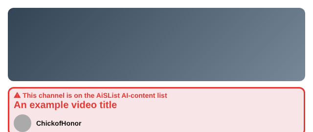
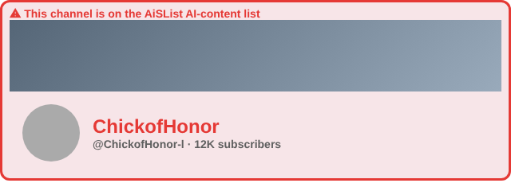
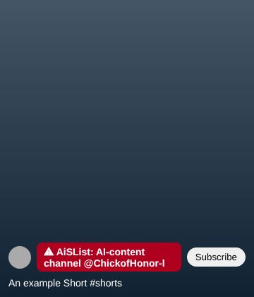
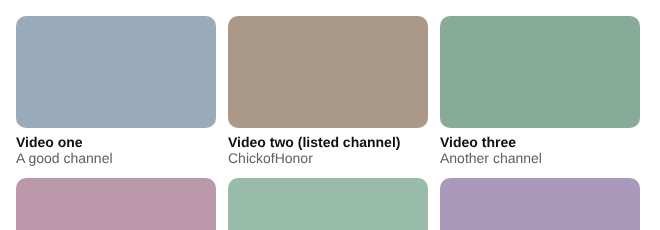
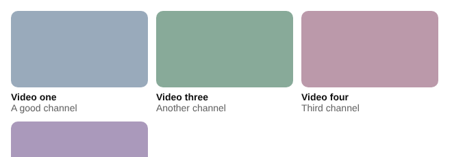
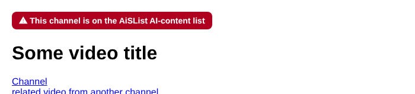
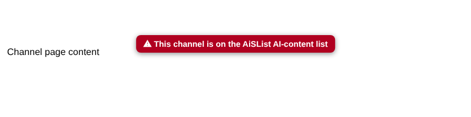

# AiSList for uBlock Origin, Brave and AdGuard

Auto-updating, **unofficial** lists that bring the community
[AiSList](https://github.com/Override92/AiSList) blocklist of AI-generated YouTube channels to
your ad blocker. There are two lists, because blockers differ in what they can do:

| | **uBlock Origin list** | **Compatible list** |
|---|---|---|
| File | `aislist_ublock.txt` | `aislist_compat.txt` |
| Works in | uBlock Origin (full version, any browser it runs in, including Firefox on Android) | Brave (desktop and Android), AdGuard, and uBlock Origin too (see the table below) |
| Listed channel's page | Warning screen naming AiSList, with a **Proceed** button | The blocker's own blocked page. Brave shows a Proceed button, but its text is a generic "This site may attempt to track you across other sites" (it never mentions AiSList), and you sometimes have to click Proceed twice. AdGuard's page is untested |
| Video pages and desktop Shorts | Red text notice | Red text notice (a label above the title, or in front of the channel name on Shorts) |
| Channel pages (after Proceed) and mobile Shorts | Red text notice | Red text notice (above the channel header, or in front of the channel name on Shorts) |
| Listed channels' videos in feeds, search, suggestions | Hidden | Hidden |
| Size | 3.8 MB | 6.5 MB |

Use the uBlock Origin list if you use uBlock Origin: it can explain *why* something is flagged.
Use the compatible list for Brave's built-in blocker (Shields), AdGuard and similar.

A GitHub Action checks upstream every 6 hours, converts the list with `scripts/convert.py`, and
commits both files only when something changed. Your blocker refreshes the list on its own.

## Examples

These images were rendered on simplified test pages that copy YouTube's real element structure, using
the actual filters from the lists. They are **not screenshots of the live site**, so spacing and fonts
on YouTube will differ.

**Compatible list** (Brave, AdGuard, uBlock Origin)

| Video page | Channel page |
|---|---|
|  |  |

| Short (desktop and mobile site) | Feed: before and after |
|---|---|
|  |   |

**uBlock Origin list** (video page notice and the floating notice on channel pages)

| Video page | Channel page |
|---|---|
|  |  |

## Install: uBlock Origin list

**One click:** [Subscribe in uBlock Origin](https://subscribe.adblockplus.org/?location=https%3A%2F%2Fraw.githubusercontent.com%2Fnmknm%2Fublock-aislist%2Fmain%2Faislist_ublock.txt&title=AiSList%20for%20uBlock%20Origin)

**Manual:** uBlock Origin → Dashboard → **Filter lists** → **Import…** → paste

```
https://raw.githubusercontent.com/nmknm/ublock-aislist/main/aislist_ublock.txt
```

then click **Apply changes**.

## Install: compatible list (Brave, AdGuard, and others)

The address of the list is:

```
https://raw.githubusercontent.com/nmknm/ublock-aislist/main/aislist_compat.txt
```

- **Brave (desktop):** open `brave://settings/shields/filters` (or `brave://adblock`), choose
  **Add filter list via URL** (or *Add custom filter list*), paste the address.
- **Brave (Android):** Settings → Brave Shields & privacy → Content filtering, then add the list by URL.
  These are the steps from Brave's help pages; I haven't tried them on a phone.
- **AdGuard browser extension:** Filters → **Custom** → **Add custom filter**, paste the address.
  The AdGuard apps (Windows, Mac, Android) also take custom filters by URL in their filter settings;
  I haven't tested them.
- **uBlock Origin** also accepts this list, but the uBlock Origin list above is the better choice there.

### Which blockers work

I ran the actual filtering code of each blocker (Brave's open-source engine and page script,
AdGuard's `tsurlfilter` and `ExtendedCss` libraries, and uBlock Origin's own parser) on test pages built from
real YouTube page structure. I did not run the full browsers or the apps.

| Blocker | Compatible list |
|---|---|
| Brave Shields, desktop | Works (tested with Brave's engine and page script) |
| Brave Shields, Android | Expected to work: Brave documents the same filtering engine on both |
| AdGuard browser extension | Works (tested with AdGuard's engine and `ExtendedCss`) |
| AdGuard apps (Windows, Mac, Android) | Expected to work (they use AdGuard's `ExtendedCss` too), but I haven't tested them |
| uBlock Origin (full) | Works |
| uBlock Origin Lite, Safari content blockers (1Blocker and similar), iOS blockers | **Not supported**: they can't run these filters |
| Adblock Plus, AdBlock | Not supported; at most the channel-page blocking would apply (not tested) |

## What the uBlock Origin list does

For about 34,000 listed channels, it does three things:

1. **Warns before opening a channel page.** If you open a listed channel's page (for example from a
   link on another site, a bookmark, or a typed URL), uBlock Origin shows its "page blocked" screen,
   naming this list, with a **Proceed** button.
2. **Warns on video pages.** When you watch a video from a listed channel, a red notice appears above
   the video title: "This channel is on the AiSList AI-content list". This also works when you click
   through from inside YouTube.
3. **Warns on Shorts and on the mobile site.** On desktop Shorts, on mobile Shorts, and on video pages
   on m.youtube.com, the same notice appears as a small floating label near the top of the screen.
4. **Warns on channel pages.** After you click **Proceed** on the "page blocked" screen, the same
   floating notice stays on the channel page, so you're reminded while you browse it. It's matched by
   the page address, so it also appears when you open a listed channel from inside YouTube.
5. **Hides their videos.** Video, channel and playlist cards from listed channels are hidden in feeds,
   search results and suggestions.

Everything above also works on m.youtube.com: the "page blocked" screen, the channel-page notice, hidden
cards (feed, search, suggestions), and the video-page and Shorts notices. Nested cards are hidden as a
whole, so no empty gap is left in the feed.

## What the compatible list does

Same channels, a bit fewer features:

1. **Blocks listed channel pages** with your blocker's "blocked" page. In Brave this page has a
   Proceed button, but its warning text is Brave's generic tracking message, not AiSList's, and it
   sometimes needs two clicks. That text can't be changed from a filter list.
2. **Hides their videos** in feeds, search results and suggestions (desktop and mobile site).
3. **Shows a text notice on video pages** (desktop and mobile site): "This channel is on the AiSList
   AI-content list" above the title, with a red tint and frame.
4. **Shows a short label on Shorts** (desktop and mobile site), in front of the channel name.
5. **Shows the text notice on channel pages** (desktop and mobile site) above the channel header, for
   example after you click Proceed. The channel is recognised from the page address.

How the text works without `::before` (which Brave and AdGuard can't add): an ordinary element is
turned into a list item whose bullet is the notice text (`list-style: inside "..."`), so the
browser draws the text in front of the element's content. It needs a plain block element, so it is
used only where the page structure is known (video pages, channel page headers and the Shorts channel name).

The patterns are also written differently from the uBlock Origin list (no `/` inside them, no flags,
letters spelled as `[aA]`) because Brave and AdGuard each reject something the uBlock Origin patterns
use; that is why this list is larger.

## Performance

An earlier version made the browser compare every link on a YouTube page with about 34,000 separate
filters, which made YouTube lag badly. Channels are now packed into a few compact patterns, and each
link is tested once. On a test page of 300 video cards, in headless Chromium:

| | Old | Now |
|---|---|---|
| Load 300 cards | 28 s | 0.3 s |
| A new card appears (scrolling) | 59 ms | 8 ms |
| A page of 12 new cards appears | 500 ms | 10 ms |

For the compatible list, Brave's own page script scans a page of 300 cards with all its filters in about
44 ms and handles 12 newly loaded cards in about 3 ms. The same cards are hidden as before. These are lab numbers from a simplified test page (YouTube's real
pages are heavier), but the difference is large. The conversion script checks its own patterns on every
update, and refuses to publish a list that doesn't match the channels exactly.

## Known limitations

- **The "page blocked" screen only appears on full page loads.** YouTube moves between pages without
  reloading, so clicking a channel from inside YouTube won't trigger it. The video-page notices and the
  hidden cards cover that case.
- **Needs the full uBlock Origin, up to date.** It works in Brave on desktop with the uBlock Origin
  extension installed (Brave still supports it). For Brave's built-in Shields and for mobile browsers
  without extensions, use the compatible list instead. The card hiding and the notices use uBlock Origin's
  scripted ("procedural") filters, including `:matches-path`. They don't work in uBlock Origin Lite.
  If the notices never appear, update uBlock Origin. Detection by page address is reliable; the notice
  itself is a plain label that doesn't depend on YouTube's page structure.
- **Hidden cards can flash briefly.** Cards are hidden by uBlock Origin right after YouTube adds them to
  the page, not before, so a card may be visible for a moment before it disappears.
- **Shorts cards in feeds and shelves can't be hidden**, because they don't show a channel link. The
  notice appears once you open the Short.
- **Desktop Shorts can't tell which Short is on screen.** The notice looks at the channel shown on the Short player (matched on a real page). If YouTube has the next or previous Short loaded and that one is from a listed channel, the notice can appear a little early or late.
- **Mobile Shorts (m.youtube.com/shorts/...) use a generic check.** The notice appears when you are on
  a Shorts address and the page contains a link to a listed channel. It doesn't know which Short is
  on screen, so it can appear a little early or late if a neighbouring Short from a listed channel is
  loaded in the page, or if a listed channel is linked elsewhere on the page (for example in comments).
- **Compatible list: channel pages and mobile Shorts are new and untested on the live site.** They were
  built from the element names of real pages (`yt-page-header-view-model` on channel pages,
  `yt-reel-channel-bar-view-model` on Shorts) and tested on test pages, but not in a real browser.
  The layout of the mobile Shorts channel bar has not been checked, so the label may look different
  there. If a notice is missing or looks wrong, please open an issue saying which page and browser.
- **Compatible list in Brave: warnings can linger.** Brave only adds styles and never takes them back
  off (confirmed on live YouTube). After you move from a listed channel or video to another page inside
  YouTube, the old warning can stay on an element YouTube reuses, so it may show on an unlisted
  channel. Reloading the page (F5) clears it. A filter list can't fix this. uBlock Origin and AdGuard
  remove the warning correctly.
- **Compatible list: tested with Brave's and AdGuard's own code** on test pages copied from real
  YouTube page structure. Live testing so far was in Brave only; AdGuard and the apps have not been
  run for real.
- YouTube changes its page structure from time to time; the notices or the hiding may stop working
  until the list is updated. If a notice doesn't appear, please open an issue saying which page you
  were on and in which browser.
- The list is about 3.6 MB, so loading or updating it takes a moment.
- On the warning screen, choose plain **Proceed**. The "don't warn again" options apply to the whole
  site, not to one channel.

## Wrong channel on the list?

Channel data comes from upstream, so report false positives or additions there:
<https://github.com/Override92/AiSList/issues>. Fixes arrive here automatically after the next sync.
Use this repo's issues only for problems with the uBlock Origin conversion.

## Credit and license

All channel data comes from **AiSList** by Override92 and its contributors
(<https://github.com/Override92/AiSList>, <https://aisloplist.com>), licensed
[CC BY-NC 4.0](https://creativecommons.org/licenses/by-nc/4.0/).

Changes made here: the list is converted into uBlock Origin page-block, warning and card-hiding
filters, and duplicate entries are removed. This project is not affiliated with or endorsed by the AiSList authors. As required by
the license, it may be used for non-commercial purposes only.

The conversion script (`scripts/convert.py`) is released under the MIT license.
